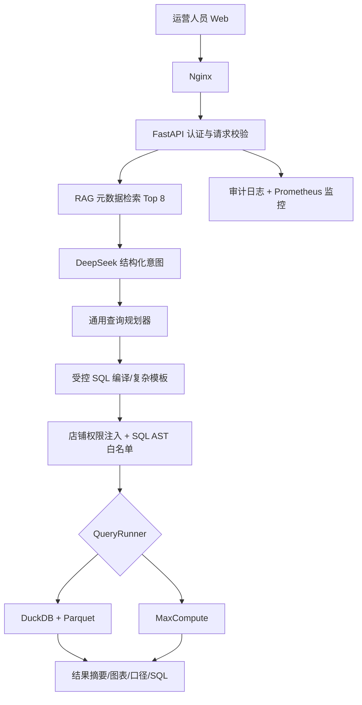

# 项目复盘与简历材料

## 1. 一句话介绍

基于 Amazon US 数仓搭建面向运营人员的 AI 智能问数系统，将自然语言问题转换为受控查询计划，在店铺权限和 SQL 安全校验后查询 MaxCompute，并返回可视化结果、指标口径和可追溯 SQL。

## 2. 最终架构

## 3. 面试时必须说清的主链路

用户在 Web 输入经营问题后，后端先从指标、数据集、业务术语、表关系和标准示例中召回相关知识，再让 DeepSeek 把问题解析成指标、维度、时间、筛选、排序和 TopN。后端使用能力矩阵选择数据集并编译受控 SQL，对运营用户强制注入授权店铺，然后用 SQL AST 校验只读、表和字段白名单。通过后由 DuckDB 或 MaxCompute 执行，最后返回数据、指标口径、图表和可追溯 SQL，同时记录审计和监控指标。

## 4. 两分钟面试版

我做了一个面向 Amazon 运营的 AI 智能问数系统。项目接入公司原有的 MaxCompute 数仓模型，运营可以直接问“最近30天店铺销售额 Top3”或“近7天整体退款率”。

我没有让大模型直接自由生成和执行 SQL，而是让 DeepSeek 只输出结构化意图，再由通用查询规划器根据指标、维度、时间、筛选和排序组合 SQL。这样新问题不需要一题写一条 SQL，同时可以保证指标口径。

安全方面，后端会强制注入运营的授权店铺，并用 SQL AST 校验拦截写操作、非白名单表字段、系统表和文件读取。项目通过 Docker、Nginx、FastAPI 部署，并有审计、监控、超时、CI 和回滚方案。

最终 32 道 DeepSeek 通用问法全部通过，RAG Recall@8 为 100%，SQL 安全评测 9/9，DuckDB 和 MaxCompute 三类关键口径结果一致。

## 5. 五分钟版展开顺序

1. 业务问题：固定看板不能覆盖运营的临时分析问题。
2. 数据底座：6 张 Amazon US 数仓表，本地 DuckDB 和云端 MaxCompute 共用口径。
3. AI 设计：RAG 召回数仓知识，DeepSeek 产生结构化意图。
4. Text-to-SQL：通用查询计划和能力矩阵，复杂派生指标保留专用模板。
5. 口径决策：店铺订单数不从 SKU 日表直接累加，退款率使用比值重算。
6. 安全：认证、店铺权限、AST 白名单、只读 MaxCompute 账号、审计和超时。
7. 工程化：FastAPI、Nginx、Docker、Prometheus 指标、日志轮转、CI、回滚和密钥轮换手册。
8. 评测证据：意图、检索、SQL、权限、双引擎结果和 Token/耗时。
9. 限制：没有购买 ECS 做公网长期运行，历史记录暂存浏览器本地。

## 6. 简历项目描述

**Amazon US AI 智能问数系统 | Python / FastAPI / DeepSeek / RAG / DuckDB / MaxCompute / Docker**

- 基于 Amazon US 数仓设计面向运营的自然语言问数系统，打通 Web、DeepSeek、受控 Text-to-SQL 与 MaxCompute 查询链路。
- 设计指标、维度、时间、筛选、排序和 TopN 的通用查询规划器，支持基础经营问题组合生成 SQL，并保留北极星、SKU 生命周期等复杂口径模板。
- 建立指标/数据集/术语/表关系/示例的 RAG 检索层，Top 8 文档召回率 100%，在减少 75% 上下文后保持 32/32 通用问法通过。
- 实现管理员/运营角色与店铺级权限注入，使用 `sqlglot` 完成 SQL AST 只读、表/字段白名单及外部文件读取拦截，安全评测 9/9 通过。
- 建立 84 项自动化测试、DuckDB/MaxCompute 结果对照、DeepSeek Token/耗时统计、Docker/Nginx 生产模拟、审计监控、CI、回滚与密钥轮换方案。

## 7. 简历表述边界

可以写“对接 MaxCompute”、“完成 Docker/Nginx 生产模拟和 ECS 迁移方案”。当前不应写“已在 ECS 公网长期生产运行”，也不应声称完成真实公司多用户验收。

## 8. 演示脚本

1. 用管理员令牌查询“最近30天销售额排名前3的店铺”，展示图表和 SQL。
2. 勾选“沿用上一问”，追问“换成最近7天”。
3. 用运营令牌查询同一问题，展示只返回授权店铺。
4. 查询“近7天整体退款率”，说明加权口径和 RAG 指标知识。
5. 输入缺少时间的问题，展示系统澄清；介绍不安全的店铺订单数为何被拒绝。
6. 展示 `/metrics`、审计日志和统一评测报告。

我们把智能问数服务独立成了一个 FastAPI API，Quick BI 看板作为运营入口，通过嵌入页面或嵌入链接接入问数区域。运营在看板旁边输入自然语言问题，Quick BI 前端把请求转发到问数服务，服务完成权限校验、RAG、Text-to-SQL 和 MaxCompute 查询后，把结果返回并展示在看板区域。这样问数能力和BI展示层解耦，后续也可以接入钉钉、飞书或其他运营后台。

如果面试官追问具体嵌入方式，可以补充：

具体采用 iframe、嵌入分析组件还是Quick BI扩展能力，要根据公司购买的Quick BI版本和开放能力确定；当前项目先按独立Web加标准API实现
